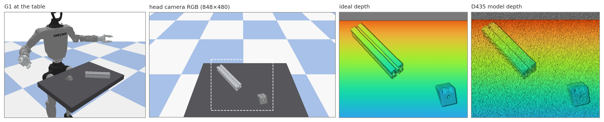
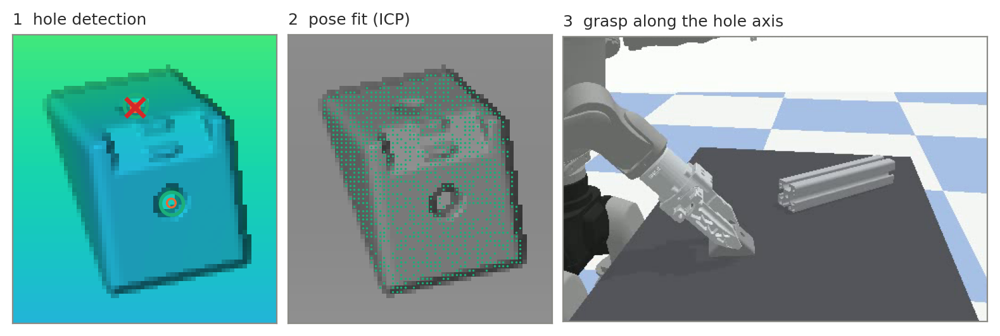
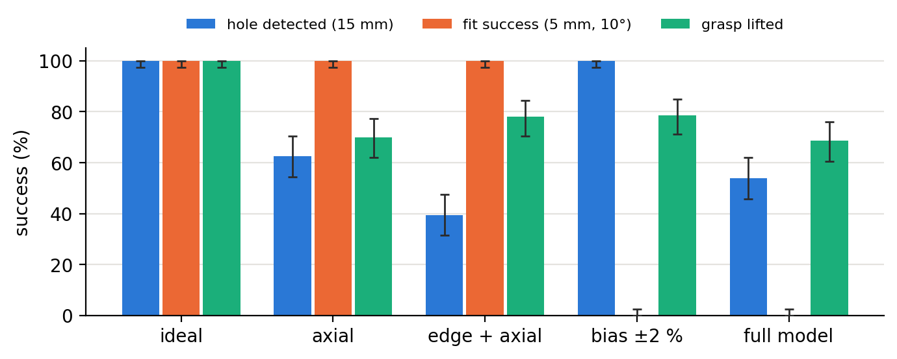
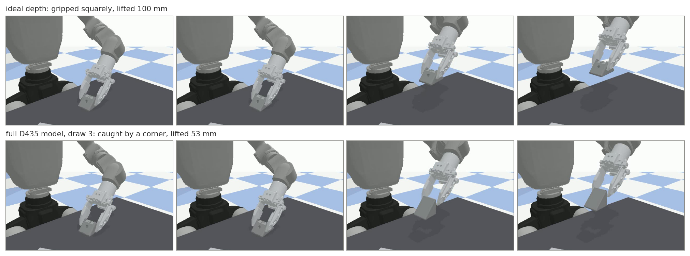

# Synthetic RGB-D of a manufacturing cell with a RealSense D435 depth model

A Unitree G1 humanoid picks an angle bracket from a table next to an aluminium profile, using its head camera,
an Intel RealSense D435. This repo renders labelled synthetic RGB-D frames of the cell, corrupts the ideal depth
with an analytical D435 model built from Intel's published numbers, and runs a depth-only downstream task on
it: detect the bracket's top hole in 6D, fit the bracket's CAD model, and grasp the bracket with the jaws
approaching along the hole axis.

**Report:** [report/report.pdf](report/report.pdf) · **Video (3 min):** [report/explainer.mp4](report/explainer.mp4) ·
**Reproduction:** [REPRODUCE.md](REPRODUCE.md)





## Results

Does the D435 model change the outcome of the three stages? 7 depth conditions on 30 held-out test scenes
(every stage succeeds with ideal depth), 5 paired noise draws each:

| Condition | Hole detected | Pose found (15 mm) | Grasp lifted |
|---|---|---|---|
| ideal | 100 % | 100 % | 100 % |
| datasheet rules | 97 % | 100 % | 77 % |
| axial noise | 63 % | 100 % | 70 % |
| edge fattening | 100 % | 100 % | 73 % |
| edge + axial | 39 % | 100 % | 78 % |
| depth bias ±2 % | 100 % | 100 % (~10.7 mm off) | 79 % |
| full model | 54 % | 99 % (~11.1 mm off) | 69 % |



- **Hole detection** is hit hardest: axial noise breaks up the bracket's faces and leaves false holes, and edge
  fattening with noise closes real ones.
- **The CAD fit** absorbs the detection errors, but the depth bias passes through it as a ~11 mm shift.
- **The grasp** failures are all planning failures (no reachable, collision-free arm motion). Even the 1 mm
  depth rounding alone lowers the grasp rate, so the drop reflects the planner's sensitivity as well as the
  camera.



The perception results were repeated on Isaac Sim depth with a similar pattern. A check of the camera model
against real D435 depth (HAMMER dataset) is in the report, Section 5.

## Setup

Linux, CPU only (PyBullet). Step-by-step reproduction, from re-analysing the published results to a full
rerun: [REPRODUCE.md](REPRODUCE.md).

```bash
conda env create -f environment.yml
conda activate synthetic_rgbd
```

Run all scripts from the repo root. Everything needed for the PyBullet path is in the repo: part CAD, robot
model and the reference frames.

**Isaac Sim (optional).** The Isaac backend renders the same scene with Isaac Sim 5.1 (NVIDIA GPU, Linux) and is
only used to cross-check the PyBullet frames; the two agree to 0.00 mm median depth on the parts.

```bash
pip install "isaacsim[all,extscache]==5.1.0" --extra-index-url https://pypi.nvidia.com
export OMNI_KIT_ACCEPT_EULA=YES
export G1_USD=/path/to/g1_29dof_with_dex1_base_fix1.usd   # G1 + Dex1 USD, not in the repo (77 MB)
```

Add `--backend isaac` to the render and evaluation scripts to use it. Isaac renders one seed per process.

## Quick start (ideal depth)

```bash
python scene/render.py --seed 4 --out /tmp/frame      # one frame: rgb, depth, instance mask, meta
python scene/render.py --seed 4 --gui                 # the scene in the PyBullet GUI
python perception/eval_holes.py                       # hole detector on the 15 development seeds
python perception/eval_bracket_fit.py                 # 6D bracket fit on the 15 development seeds
python robot/grasp_hole.py                            # grasp the 15 development seeds; videos of the first 2
```

Expected on ideal depth (development seeds, chosen so that every stage succeeds, so this is the baseline for
the camera model, not an accuracy measure):

| Step | Result |
|---|---|
| Hole detector | 15/15; centre error median 0.70 mm, axis 0.71° |
| Bracket fit | 15/15; translation median 0.34 mm, rotation 0.84° |
| Grasp | 15/15 lifted ~100 mm |

## D435 camera model

`camera_model/d435.py` turns ideal depth into D435-like depth. It works on saved frames, independent of the
simulator. Every effect has a published number, applied in the order it arises in the camera:

1. **Edge fattening:** at depth steps the foreground grows 2 px into the background, so gaps of 4 px or less
   close. No D435 value exists; the value is the R200's (Keselman et al. 2017) and needs calibration against
   a real D435.
2. **Axial noise:** Intel's σ_z = z²·s/(f·B) with s = 0.08 px (tuning guide), applied as disparity noise.
3. **Depth bias:** at the datasheet's Z-accuracy limit (±2 %), modelled as a scale error with a random sign per
   noise draw (the form and sign are our assumption).

plus the datasheet output rules: left invalid band, Min-Z 195 mm, 1 mm depth unit. The math, sources and the
effects left out are in [docs/camera_model.md](docs/camera_model.md).

```bash
python camera_model/d435.py                                     # noise levels and what each step does
python perception/eval_holes.py --camera d435 --runs 10         # 10 noise draws per development seed
python perception/eval_bracket_fit.py --camera d435 --runs 10
python robot/grasp_hole.py --camera d435 --seeds 45 --run-ids 0 --close-view
```

Ablations: `--edge none`, `--axial ahn` (Ahn et al. 2019, ~2.7× Intel's noise at 0.5 m) or `--axial none`,
`--bias 0` (or a fixed `--bias 2` / `--bias -2`, in %), `--no-rules`. Noise draw r of seed s uses the same
random numbers, including the bias sign, in every script and model variant.

**Mitigation (reported separately).** `perception/hole_detector_tuned.py` is the same detector with its
thresholds scaled to the expected noise (k·σ_z, k = 2.5 by default):

```bash
python perception/eval_bracket_fit.py --camera d435 --runs 10 --detector tuned [--k-sigma 3]
```

## Final experiment

```bash
python experiments/final_sweep.py all          # select seeds, run, analyse; opens a live view (--no-view to skip)
python experiments/run_seed.py --seed 432 --condition 6_full --run 0 [--gui]   # one case, same numbers
python experiments/extract_examples.py         # example figures + grasp videos -> extracted_examples/
```

Results: `output/final_sweep/results/table.md` (also `.csv`, `.html`), plots in `output/final_sweep/plots/`,
per-draw rows in `results/rows_*.csv`. Examples with grasp videos: [extracted_examples/](extracted_examples/README.md).
Other outputs go to `output/`, which git ignores except for the final results.

## Reference data

`DEV_SEEDS` (15) and `TEST_SEEDS` (30) are in `scene/config.py`; the selection rule is in the comment above
them. `data/ideal/<backend>/seed_XXX/head/` holds the ideal frames for both backends:

| File | Content |
|---|---|
| `rgb.png` | colour image, 848×480 |
| `depth.npy` | float32 z-depth in metres, 0 = no return |
| `instance.npy` | per-pixel id: 0 background, 1 table, 2 robot, 3+ parts |
| `depth_vis.png` | colour-mapped depth for viewing |
| `meta.json` | intrinsics K, camera pose (ROS optical frame) and the scene spec, including the ground-truth part poses |

Regenerate the development frames with `python scene/render.py --dev-seeds` (PyBullet).

## Layout

```
scene/              scene definition shared by both backends (config, parts, materials, spec, render CLI, backends/)
camera_model/       d435.py (D435 model), validate_hammer.py (model vs real D435 depth)
perception/         hole_detector.py, hole_detector_tuned.py (mitigation), bracket_fit.py, evaluation scripts
robot/              grasp_hole.py: IK with an arm-body collision check, grasp selection and execution
experiments/        final_sweep.py, run_seed.py, watch.py (live view), extract_examples.py
extracted_examples/ example figures and grasp videos from the final sweep
assets/             part CAD (STEP) and the G1 + Dex1 URDF
data/ideal/         ideal reference frames
docs/               pipeline.md and camera_model.md (algorithms and math), Intel documents used
report/             report.tex / report.pdf, figures, explainer video
AI_LOGS.md          working log of the AI assistant (decision history; not written for readers)
```

## Sources and modifications

**Parts.** item Industrietechnik CAD: profile 8 40×40 light (0.0.452.81), cut to 200 mm, and angle bracket set
8 40×40 (0.0.670.11) with nuts, screws and locating lugs removed, holes drilled through at Ø8.5 mm, cover cap
kept. Steps in the `scene/parts.py` docstring.

**Robot.** `assets/robot/g1_dex1/` is Unitree's `g1_29dof_mode_15_with_dex1_1.urdf` from
[unitree_ros](https://github.com/unitreerobotics/unitree_ros), with relative mesh paths, the `world` and
rubber-hand links removed, and `*_hand_base_link` and fingertip frames added. The camera frame `d435_link` is
from the original URDF.

**Camera.** Intel RealSense D400 datasheet, depth tuning guide, depth post-processing paper and depth testing
methodology (in `docs/`); Keselman et al., CVPRW 2017 (edge fattening, R200); Ahn et al., UR 2019 (noise
ablation); Jung et al., CVPR 2023 (HAMMER, realism check).

The Intel documents are in `docs/`. The three papers are not included for copyright reasons; code comments
refer to them by their local file names: Keselman et al. ([arXiv 1705.05548](https://arxiv.org/abs/1705.05548),
`docs/1705.05548v2.pdf`), Ahn et al. (IEEE UR 2019, `docs/793350771-ANM.pdf`) and Jung et al. (CVPR 2023 open
access, `docs/Jung_HAMMER_CVPR2023.pdf`).
